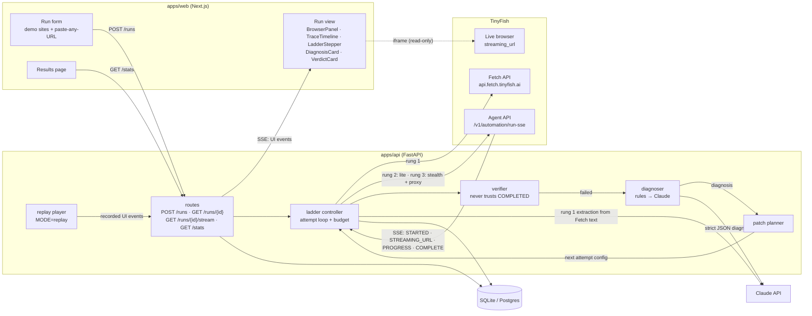

# Architecture

The browser only talks to our API. The API holds both API keys and is the only thing that calls TinyFish and Claude. The one direct browser → TinyFish link is the read-only live-view iframe (`streaming_url`), which TinyFish documents as safe to expose.

## One attempt, end to end

1. The ladder controller builds the attempt's config: rung, goal (with any patch applied), output schema, browser profile and proxy.
2. It calls TinyFish: Fetch on rung 1, the Agent SSE stream on rungs 2 and 3. Every TinyFish event is stored verbatim and forwarded to the web app as a UI event.
3. The verifier checks the result against the user's expected-output check and the output schema, and looks for block signals: access-denied text, 403s, login forms, captcha markers, and a null result next to `COMPLETED`.
4. If the check fails, the diagnoser classifies the failure and returns the failing step, the evidence and a patch. The planner turns the patch into the next attempt's config, or stops the run when the failure is unrecoverable or the budget is spent.
